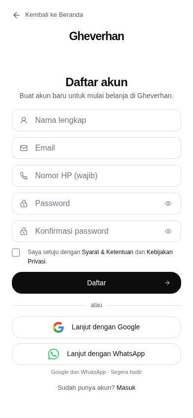
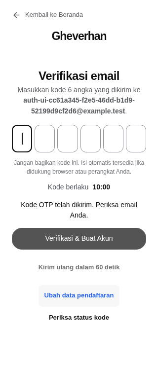
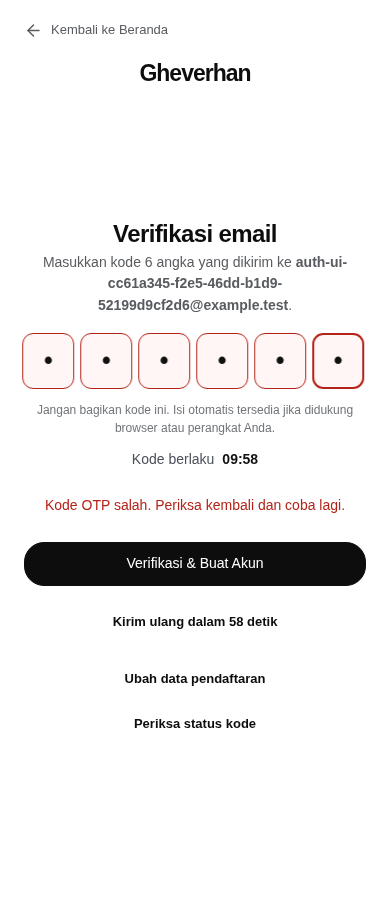
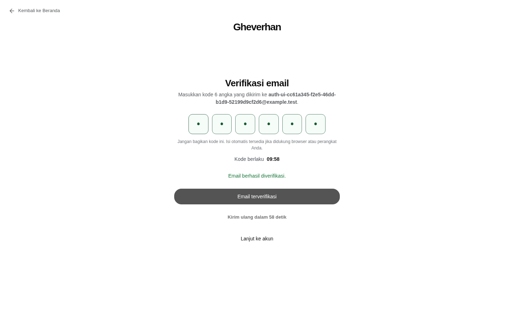

# Perbaikan konflik registrasi dan pengalaman OTP

Baseline: `main@12f7a4589ff50dbf2f3c70f19dd92b98df19fcd9`, setelah PR #70 di-merge. Branch: `fix/registration-conflicts-otp-experience`. Seluruh pengujian memakai data dummy, provider loopback/mock, Node.js 22, dan PostgreSQL 17 disposable. Tidak ada akses atau perubahan Production dalam pekerjaan ini.

## Root cause dan perbaikan

1. `requestRegistrationOtp` sebelumnya sengaja menunda pemeriksaan akun existing sampai verifikasi untuk mengurangi enumeration. Akibatnya email/phone existing tetap menerima OTP dan pending state dapat diganti. Reproduksi menggunakan service asli baseline gagal pada ekspektasi penolakan awal (`Missing expected rejection: email`). Kebijakan baru yang diminta pemilik diterapkan sebelum menyentuh pending state/provider, di jalur Server Actions dan REST yang memakai service bersama.
2. Client sebelumnya menetapkan deadline `Date.now() + 10 menit`, termasuk sebelum hasil resend diketahui, dan memulihkan challenge lokal tanpa validasi server. Deadline/cooldown kini berasal dari row server; reload memvalidasi private challenge melalui status action. Respons resend yang hilang direkonsiliasi, bukan dianggap berhasil dan diberi deadline baru.
3. Pesan verifikasi sebelumnya menyatukan kode salah, expired, dan batas percobaan. Error terstruktur sekarang membedakan ketiganya. Redirect langsung sebelumnya tidak memberikan state sukses yang dapat dipercaya; UI hijau sekarang hanya sesudah transaksi akun dan pembuatan sesi sukses di server.
4. Pencarian identitas pada role yang terfilter RLS dapat memberikan hasil kosong yang keliru. Guard memeriksa `row_security_active` pada statement lookup yang sama dan menolak 503 bila visibilitas identitas tidak lengkap. Kegagalan database tetap fail-closed.

5. Regression tambahan membuktikan SQL POSIX whitespace pada locale PostgreSQL tidak identik dengan JavaScript `trim()/\s`: phone legacy berisi non-breaking space sempat lolos. Lookup sekarang memakai himpunan whitespace ECMAScript eksplisit dengan `translate`/`btrim`, termasuk NBSP/BOM; test legacy Unicode gagal sebelum perbaikan dan lulus sesudahnya.

6. Review Codex menemukan dua P2: ref retry tidak memicu penjadwalan ulang setelah status `sending` gagal dibaca, dan pesan restart selalu mengalahkan hasil submit terbaru. Tiga regression tests mereproduksi kedua temuan sebelum perbaikan; satu test tambahan memastikan metadata `sending` baru tidak mereset budget empat pemeriksaan otomatis. Retry kini berupa state yang bergerak setelah setiap respons gagal/sukses (maksimum empat, lalu fallback manual), dan feedback action terbaru menggantikan pesan/link recovery lama.

7. Review lanjutan menemukan UI melarang resend pada reservation `sending` yang tertinggal setelah worker berhenti, walaupun cooldown sudah berlalu. Tombol resend sekarang mengikuti cooldown server tanpa memblokir status tersebut; verifikasi tetap terkunci hingga aktivasi. Unit test gagal sebelum perbaikan lalu lulus sesudahnya, dan PostgreSQL test membuktikan CAS replacement reservation serta pembuatan tepat satu akun setelah kode baru valid.

## Backend dan batas keamanan

- Email trim/lowercase dan phone Indonesia dinormalisasi konsisten. Lookup juga mengenali email legacy dengan kapitalisasi dan phone legacy berformat lokal/spasi/tanda baca tanpa mengubah data lama.
- Konflik mengembalikan 409 dengan pesan gabungan: **Email atau nomor HP sudah terdaftar. Silakan masuk atau reset password.** Tidak membedakan field/akun aktif dan nonaktif; identitas nonaktif tetap dicadangkan oleh unique constraint.
- Tidak ada pending mutation atau provider call pada konflik yang sudah ada. Pemeriksaan diulang sebelum/ sesudah provider, saat resend, dan dalam transaksi final. Unique constraint Prisma tetap menjadi perlindungan akhir; `P2002` menjadi konflik terkontrol.
- Pembuatan User, Customer, Cart, Wishlist, role, AuditLog, dan consume challenge tetap atomik. Tidak ada User/session sebelum kode valid. HMAC terikat email + generation, reservation `sending:` tidak dapat diverifikasi, compare aman, maksimum lima percobaan, TTL 10 menit, cooldown 60 detik.
- Kuota lama dipertahankan: tiga request/resend per email per jam, 30 global per menit; tambahan kuota tiga per phone kanonis per jam menutup rotasi email/format nomor. Verify tetap 12 per email per jam dan kuota private generation; status dibatasi 60 per generation per jam/240 global per menit. Bucket menggunakan digest dan realm server, bukan identitas mentah atau nilai realm dari request.
- Pending yang expired dipertahankan paling lama jendela pemulihan 30 menit setelah expiry untuk resend. **Kode expired tetap tidak valid.** Retensi oportunistik ini dapat mencapai sekitar 40 menit sejak pengiriman; tidak mengirim email otomatis. Setelah jendela berakhir, pengguna mendaftar ulang.
- Status POST memerlukan pasangan email + UUID generation privat, memeriksa Origin pada REST, tidak mengembalikan password/hash/kode/attempts. Server Actions mempertahankan perlindungan Origin bawaan Next.js. Unknown generation tidak menghabiskan kuota verifikasi email milik korban.
- Login/logout/reset/JWT/revocation dan aturan transaksi bisnis tidak diubah. File cart browser hanya disesuaikan agar tidak menekan submit dua kali setelah autosubmit OTP.

## UI dan pemulihan

- Tombol **Daftar**, pesan konflik dengan link **Masuk** dan **Lupa password**, input form tidak hilang saat gagal.
- Enam slot visual pada satu native input: numeric, `autocomplete="one-time-code"`, selection, keyboard, backspace/delete, paste, native autofill, serta autosubmit sekali per kode lengkap. Tombol verifikasi tetap tersedia; paste lebih dari enam digit ditolak agar tidak menghabiskan attempt dari potongan kode.
- Border merah dan shake 360 ms hanya pada penolakan OTP server; hijau dan feedback keberhasilan hanya setelah server mengonfirmasi akun/sesi. Pending terkunci untuk mencegah double-submit. Network error tidak memalsukan state hijau atau mereset deadline.
- Countdown `MM:SS` menggunakan metadata waktu server dan offset jam client. Reload memulihkan `{email, challengeId}` saja; password, kode, hash, dan deadline tidak disimpan dalam `sessionStorage`/`localStorage`.
- Challenge hilang/berganti atau konflik mengembalikan form yang valid. SMTP gagal menghapus reservation yang sesuai. Lost resend response meminta status server; status `sending` dipoll terbatas, lalu tersedia pemeriksaan manual.
- Autofill email bergantung browser/OS; tidak dijanjikan pada semua perangkat. Tidak ada pembacaan Gmail/notifikasi atau penyalahgunaan WebOTP SMS.
- Tampilan satu kolom, slot 56px, tap target 44px, focus/selection jelas, reduced motion, live feedback, dan tanpa overflow pada 320–1920px. Link Back Home, login, dan reset tetap berfungsi. Konten/status legal tidak diubah.

## Pengujian dan bukti

Verifikasi lokal yang benar-benar dijalankan sebelum commit:

| Gate | Hasil |
| --- | --- |
| Node.js 22, locked install, Prisma generate dan fresh deploy tujuh migrasi pada disposable PostgreSQL | PASS |
| TypeScript, ESLint, production build | PASS |
| Unit | 257 PASS |
| Critical containment / security mitigation | 25 / 9 PASS |
| Registration OTP lifecycle PostgreSQL | 15 PASS |
| Konflik identitas, canonical phone quota, metadata, expiry recovery, provider race, RLS, stranded sending | 8 PASS |
| Auth/session/reset PostgreSQL | 12 PASS |
| Chromium auth/legal | 15 kelompok PASS, sembilan viewport 320/360/375/390/430/768/1024/1440/1920 |

Browser membuktikan penolakan REST email/phone/both sebelum email/pending, form validation, private challenge/Origin, keyboard/paste/native autofill, satu autosubmit, merah setelah penolakan, hijau setelah sukses, reduced motion, expiry, locked attempts, reload, resubmission, SMTP failure, respons resend sengaja diputus setelah backend memproses, pemulihan challenge terhapus, login/logout/reset/session revocation, legal dan link affordance. Error transport dari fault injection dicatat terpisah; unexpected console/page errors tetap membuat test gagal.

Workflow `test-containment.yml` dan `sprint-2e-isolated-regression.yml` wajib dijalankan pada HEAD PR final. Workflow kedua mempertahankan database entrypoint/preflight, migration lock/recovery, cart concurrency, product, checkout, payment/refund/shipping, browser product/operations, hydration replay, dan navigation **10×44**; menambahkan delapan kelompok konflik baru tanpa melewati gate lama. Hasil final yang terikat SHA, link Actions, dan status review dicantumkan di PR. Hasil source baseline tidak dipakai sebagai bukti source final.

Screenshot berasal dari browser lokal build production; data dummy dan digit OTP sengaja disamarkan. Screenshot dibuat sebelum commit dari source yang sama dan berfungsi sebagai bukti visual, bukan pengganti hasil CI pada commit final.

| Mobile register | OTP 320px |
| --- | --- |
|  |  |

## Risiko residual dan deployment

- Penolakan awal yang diminta pemilik menciptakan oracle keberadaan identitas. Pesan gabungan, kuota email/phone/global, dan tidak adanya endpoint per-keystroke membatasi, tetapi **tidak menghapus** risiko enumeration. Jangan mengklaim respons ini sepenuhnya anonim. Monitor 409/429 secara agregat tanpa identitas/kode; edge anti-abuse dapat dievaluasi terpisah bila diperlukan.
- Normalisasi legacy melalui ekspresi SQL dapat memerlukan scan User. Kuota membatasi frekuensi; functional index/migrasi hanya perlu dievaluasi terpisah bila pengukuran volume menunjukkan kebutuhan, bukan diterapkan diam-diam.
- Identitas yang baru diklaim ketika email provider sedang menerima request dapat tetap memperoleh email yang sudah terkirim. Email tidak bisa ditarik kembali; pemeriksaan setelah provider mencegah aktivasi challenge/akun duplikat. Test menahan provider dan membuktikan reservation dibersihkan.
- Tanpa migration baru dan tanpa perubahan dependency/lockfile. Migration OTP existing `20261018150000_registration_email_otp` tetap checksum SHA-256 `eec85ff983628830923da3c7b0760bfc20378bdcf9cb7376dd6b1cca539eb84e`. Jangan menjalankannya ulang di Production.
- `frontend/vercel.json` menonaktifkan Git deployment **branch fitur ini** untuk mencegah Preview PR menyentuh resource bersama. Tidak mengubah project settings/secret/alias Production. Operator tetap perlu memastikan deployment hooks/manual promotion tidak dijalankan tanpa izin.
- Rollback source dapat kembali ke baseline OTP-compatible `12f7a45` setelah persetujuan operator, tetapi bug duplicate/timer akan muncul kembali. Jangan kembali ke versi sebelum session revocation/OTP. Utamakan roll-forward bila menyangkut integritas autentikasi; tidak drop/reset schema atau pending/customer data.
- Merge dan deployment menunggu persetujuan pemilik. Pengiriman Resend dan native autofill pada perangkat nyata belum diuji di Production; automated test menggunakan mock/loopback tanpa email nyata. Tidak ada migrasi, backup, invalidasi sesi, atau smoke test finansial Production dalam scope ini.

Alternatif magic link dievaluasi dan sengaja dipisahkan: lihat [rencana keamanan](MAGIC_LINK_PLAN.md).
