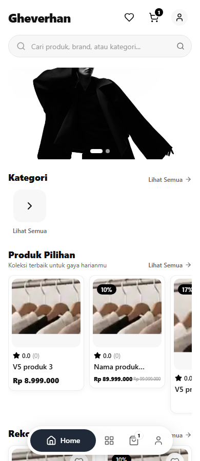
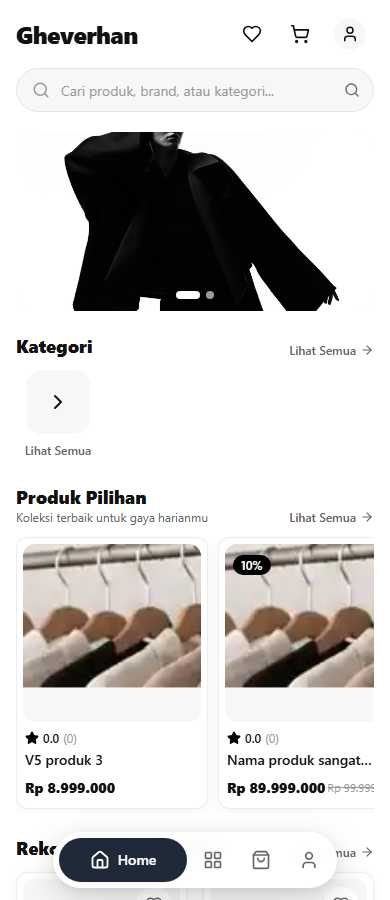
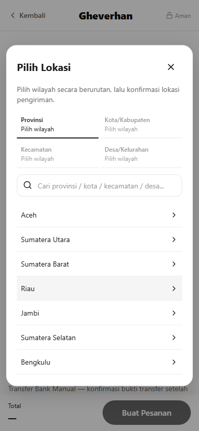

# V5 visual and browser evidence

All customer, address, product and tariff data in these captures is synthetic and belongs to a disposable local PostgreSQL environment. No purchase was made on Production. Tariff amounts in screenshots are test fixtures, not Production rates.

Before uses the actual #116 app at `3115a3646fd56f09abcfb91b529de0b40e2107db` in a detached checkout. The isolated database also accepts the additive V5 columns; no historical data is rewritten. After uses the V5 application with Chromium mobile/touch emulation and desktop viewports. Final exact-head Linux CI is linked in PR #117.

## Featured card measurements

| Viewport | Before width range | Before height range | After width × height | After width/height spread |
|---|---|---|---|---|
| 320 | 148–192 | 221.33–269.50 | 192 × 272 | 0 / 0 px |
| 360 | not captured | not captured | 192 × 272 | 0 / 0 px |
| 375 | not captured | not captured | 192 × 272 | 0 / 0 px |
| 390 | 148–192 | 221.33–269.50 | 192 × 272 | 0 / 0 px |
| 430 | not captured | not captured | 192 × 272 | 0 / 0 px |
| 768 | not captured | not captured | 238.66 × 318.66 | 0 / 0 px |
| 1024 | not captured | not captured | 324 × 404 | 0 / 0 px |
| 1440 | 449.33–449.33 | 526.83–526.83 | 449.33 × 529.33 | 0 / 0 px |

Both default and published themes passed ≤1 CSS px dimension/price-position tolerances. All final price groups start at the title's left edge. Snapshot JSON includes text font sizes, clipping checks and cart hit areas. Source data covers normal prices, discounts, five-to-eight digit amounts and a long product name. Existing CI additionally covers Flash Sale/countdowns and published dark/sage/gradient themes.

## Measured narrow-card limit

At 320px, ordinary two-column Shop cards remain 136px wide with 72px available to price text after the 44px cart target and existing padding/gaps. The eight-digit discounted pair needs 6px main / 4.50px struck type (rendered text widths 42.14px / 27.81px). It fits without clipping but is difficult to read. This is the previously approved geometric exception from #116, not a claim that tiny text solves legibility. Increasing those amounts further requires revisiting the simultaneous horizontal-price/two-column/44px-target constraints; V5 does not shrink the whole interface or change those constraints. Featured cards have substantially more room and retain their normal cap when the actual text fits.

## Before / after images

| Surface | Before | After |
|---|---|---|
| Home, 390px | [Before](evidence/home-before-390.png) | [Default](evidence/v5-featured-default-390.png), [published theme](evidence/v5-featured-published-390.png) |
| Home, 320px | [Before](evidence/home-before-320.png) | [After](evidence/v5-featured-default-320.png) |
| Home, desktop | [Before](evidence/home-before-1440.png) | [After](evidence/v5-featured-published-1440.png) |
| Checkout, mobile | [Manual address fields](evidence/checkout-before-390.png) | [Structured address](evidence/v5-checkout-ready-390.png) |
| Checkout, desktop | [Before](evidence/checkout-before-1440.png) | [After](evidence/v5-checkout-ready-1440.png) |
| Region picker | No cascading picker in #116 | [Province list](evidence/v5-region-provinces-390.png), [confirmation](evidence/v5-region-modal-390.png), [320px](evidence/v5-region-modal-320.png) |

## Machine-readable evidence

- [Baseline geometry](evidence/geometry-before.json)
- [V5 card and listing geometry](evidence/v5-featured-geometry.json)
- [Modal bounds/focus/error measurements](evidence/v5-browser-results.json)
- [Local focused regression summary](evidence/validation-results.json)

All eight modal bounds stayed within the viewport; keyboard focus remained inside the dialog and returned to its trigger on cancel. Province failure/retry, search, cascading resets, postal code, cancel/reopen, missing tariff, immediate quote reset and disabled submit passed. This is Android Chrome emulation, not physical-device testing.
