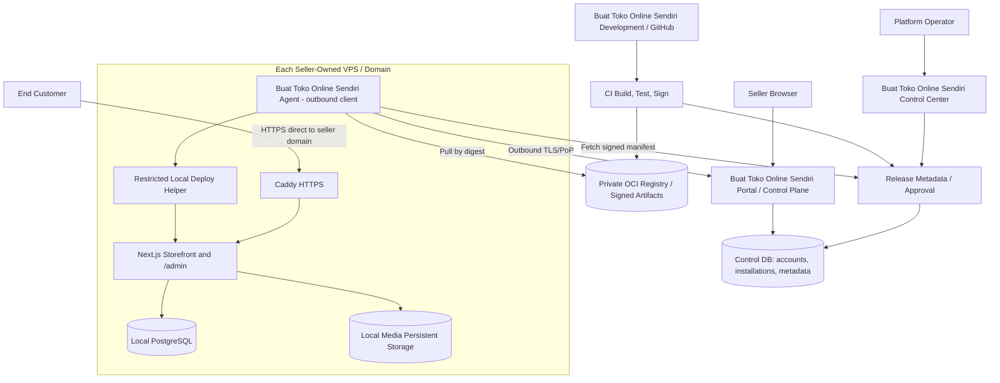
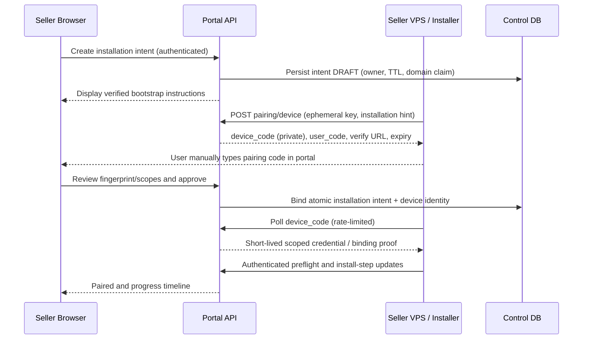
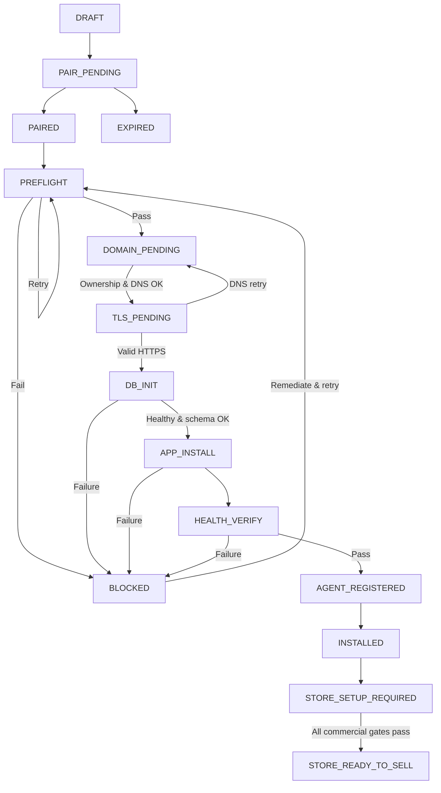

> Identitas produk diperbarui 4 November 2026. Identifier teknis lama tetap kompatibel; lihat `../rebranding-buattokosendiri/README.md`. Klaim kesiapan dalam spesifikasi ini tetap memerlukan bukti implementasi.

# Technical Architecture — Buat Toko Online Sendiri Self-Hosted V1

**Companion:** `PRD.md` (normative functional requirements). All topology is proposed until existing repository audit validates compatibility.

## A. Context and trust boundary



**Hard boundary:** No transaction data, PII, DB connection strings, shipping API secrets, customer sessions, raw payment payloads, or storage objects cross to Buat Toko Online Sendiri Control Plane. A public website must not proxy its checkout through the Buat Toko Online Sendiri installer service.

## B. Proposed repository layout

```text
/
  apps/
    portal/                # Seller dashboard, installation wizard, authenticated portal
    control-center/        # Buat Toko Online Sendiri platform operator dashboard (may share Next.js with portal)
    store/                 # Existing Buat Toko Online Sendiri/Gheverhan store app adapted to independent runtime
  packages/
    ui/                    # Reusable accessible components
    contracts/             # Zod/JSON schemas for agent <-> portal, server-side validation
    release-policy/        # Release compatibility and rollout policy (pure libraries)
  agent/
    cmd/jetseller-agent/   # Go outbound daemon
    cmd/jetseller-setup/   # Go bootstrap CLI or installer artifact
    internal/              # Pairing, state journal, checks, update planner
  deploy/
    compose/               # Compose templates for each release
    caddy/                 # Hostname-scoped config templates
    scripts/               # Authorized, versioned and signed local actions only
  docs/self-hosted/        # These specifications
  .github/workflows/       # CI, signature, provenance, staged release
```

This is a **target**, not instruction to move all existing code immediately. First minimize disruption with an architecture boundary inside current repo, then restructure if justified by CI/test evidence. Avoid committing secrets or production settings.

## C. Deployment on a seller-owned VPS

```text
Internet :80/443
      │
      ▼
Caddy (public network, persistent /data & /config)
      │ docker private network
      ▼
Next.js Store (internal :3000, not public)
      ├────── PostgreSQL (private :5432, named volume)
      └────── Uploads (persistent volume, isolated filesystem permissions)

Host service: jetseller-agent (outbound TLS only)
Local helper: fixed operation API for root-authorized install/update; localhost-only
```

- Default one application per VPS (MVP). On pre-populated VPS, preflight block or require an explicit non-destructive coexistence plan.
- Restrict Docker service names, Compose project name (`jetseller-<id>`), networks, labels, mounts and storage root to installation allowlist. Never run `docker system prune` indiscriminately.
- Agent local state in owner-protected directory such as `/var/lib/jetseller-agent`; installation config under `/etc/jetseller`; app data path under `/var/lib/jetseller/store` or named volumes.
- Agent unprivileged. Docker socket access is effectively privileged; do **not** grant broad Docker group to untrusted agent. A separate narrowly-scoped signed updater helper with local authorization performs only allowlisted operations. Audit privileged helper design before release.
- Secrets: root-owned private files / supported secret mounts, not environment values printed to CLI; no browser access to DB credentials; app runtime only sees secrets needed locally.
- Buat Toko Online Sendiri storefront and account auth continue to work during agent update or central outage.

## D. Identity model and pairing sequence

Use semantics inspired by RFC 8628. This is a *device-like pairing flow*, not a claim of OAuth compliance unless protocol is fully implemented.



Properties:

1. Device code is high entropy, secret to the agent, short TTL; `user_code` is intentionally human-readable, one time; brute force rate-limited, attempts capped.
2. Account seller must confirm target installation + visible server fingerprint, domain and requested capabilities. Multiple simultaneous pairing flows isolated.
3. Pairing creates a unique **installation_id** and **device_id**, with primary DB uniqueness constraints and atomic compare-and-swap; no duplicate registration on retry.
4. Agent persists private key via restrictive mode, attestation optional future. Center stores public key/fingerprint, not private key.
5. Use mTLS cert issuance or equivalent proof-of-possession signed requests with short-lived access tokens; implement one protocol consistently, don't invent fake mTLS if not available.
6. All counters, expiry and token rotation enforced server side. If central is inaccessible, existing store keeps working.
7. Server unbind: authenticated seller confirms; revoke credentials, stop updates; **do not erase seller data**.
8. Transfer/replace server: high-risk flow with old agent authorization or explicit seller multi-factor approval + recovery audit; never rely on knowing an IP address alone.

## E. Installation job machine

The control plane owns **intent and progress view**, but the agent is source of truth for actual local actions. Record step IDs and operation checksums durably.



- `status`: one of enumerated lifecycle states; `phase`: step identifier; `attempt`: bounded integer; `last_error_code` sanitized; `correlation_id`; created/updated timestamps in UTC (render WIB).
- Exclusive local lock for installation + upgrade, durable journal with operation IDs; no two jobs can mutate the same app/database concurrently.
- DB migrations run after DB is healthy with explicit version id and migration advisory lock; re-running a successful step is no-op.
- `abort` never deletes volumes; agent should leave system in a diagnosable condition.
- Interrupted job resumes from last safe checkpoint rather than blindly running again.

## F. Local server preflight

| Check | Failure action |
|---|---|
| Linux distro amd64, supported release | Block with required version |
| Root/sudo authorized | Block; explain secure manual prerequisites |
| RAM, CPU, free disk, inodes | Block or warn based on measured thresholds |
| Local Docker/Compose capability | Offer managed install only after user confirms, otherwise block |
| Existing services port 80/443, 5432 | Never stop others automatically; guided remediation |
| DNS/egress + TLS trust | Block until internet and time sync work |
| Container networking, firewall, public IP | Guide port setup without changing unrelated firewall rules |
| Existing Buat Toko Online Sendiri installation signature | Offer resume/repair; no duplicate installation |
| Writable persistent data directories | Block if read-only or conflicting ownership |
| Registry connectivity / signed artifact reachability | Retry with bounded backoff |

## G. Domain verification and TLS

1. Seller enters FQDN; server validates IDN normalization, reserved names, duplicate claims and domain syntax.
2. Portal issues domain ownership proof (DNS TXT under seller-controlled name); verifies authoritative answers. Allow more than one verification attempt.
3. Agent inventories server public IPv4/IPv6. Portal shows `A @ = VERIFIED_IP`, optional `CNAME www` to apex or A per provider. Never generate DNS automatically in MVP.
4. Confirm DNS A and AAAA do not resolve to wrong server; show actionable error especially unexpected AAAA.
5. Confirm inbound 80/443. Write generated Caddy config only for seller hostname after verifying it does not override an existing service.
6. Obtain TLS certificate, verify by server-side actual HTTPS request with SNI/hostname and valid chain, then mark TLS ready.
7. HTTPS certificate paths and ACME account data persist across app update. Do not rebuild Caddy state during application rollback.
8. Domain change is a separate staged operation with old hostname retained until new fully valid.

## H. Local PostgreSQL implementation

- Pin PostgreSQL major version after auditing current schema, existing migrations and client driver; example Compose uses `postgres:<supported-major>` (not `latest`).
- Dedicated database and least-privileged app role; local secret generation with cryptographically secure RNG; secure mount; restrict database to Compose private network; set `ports:` absent for db.
- Idempotent migrations with schema migration ledger. Do not leak SQL statements containing user data or secrets into telemetry.
- Back up DB + media before schema changes that may affect existing installations. Off-server encrypted backup capability should be required before accepting production readiness (or explicit risk acceptance with documented limitation).
- Database major upgrades are independent managed maintenance tasks, **not part of routine app image update**. Test DB and media restore together.
- On update, isolate app rollback from schema rollback. If migrated schema is forward-only, rollback previous app only if compatibility matrix permits; otherwise switch to safe maintenance mode and escalate.

## I. Application release and update channel architecture

```text
Git SHA → CI Tests → OCI Image (immutable sha256 digest)
                  ↘ SBOM / Provenance / Cosign Signature
                        ↓
             Signed Release Manifest (channel/version/compatibility/expiry)
                        ↓
                Buat Toko Online Sendiri Control Plane approval
                        ↓
                 Agent poll + verification
                        ↓
         local preflight → backup → deploy → health → report
```

Release manifest fields (suggested): `release_id`, `semver`, `channel`, `image_digest`, `platform_arch`, `min_agent_version`, `min_schema`, `max_schema`, `migration_policy`, `rollout_ring`, `not_before`, `expires_at`, `security_level`, `signature`, `signer_identity`, `schema_contract_version`, `rollback_to` (optional signed authorization).

- Pin image to `registry/path@sha256:...` instead of mutable tags.
- Signature verification must pin intended signing identity/trust root, not merely accept any valid certificate.
- For stronger anti-rollback / anti-freeze and key rotation, use TUF-compatible metadata library or another reviewed equivalent; do not write homemade crypto.
- Agent never executes raw shell command supplied in update payload; use allowlisted type(s) such as `APPLY_RELEASE`, `CHECK_HEALTH`, `REPORT_STATE`, `PAUSE_RELEASE` with strict schemas.
- Default update channel for new stores `stable`, but execution policy `notify_only` for early pilots. Automatic updates require opt-in and supported backup/recovery.
- Rollout approvals separately recorded from build and merge: a CI SUCCESS does not automatically authorize mass production deployment.

## J. Endpoints security boundary

- `https://jetseller.web.id/api/installer/v1/*` central seller/agent endpoints; dedicated auth middleware per mode, not shared public/session/agent token.
- Agent authenticates outbound only, pinned TLS trust, short-lived PoP credentials, per-install scopes, nonce/correlation, idempotency.
- Portal validates all FQDN/IP data, rejects SSRF patterns; avoid central fetching arbitrary seller URLs unless explicitly allowlisted and SSRF-hardened. Prefer DNS and certificate checks through limited purpose workers with IP policy.
- All central inputs untrusted: e.g. claimed hostname, agent version, resource metrics; treat it as self-reported until independently verified.

## K. Local app controls and first-run admin

- Installer creates a one-time local setup state; owner visits `https://<domain>/admin/setup` after TLS OK.
- Seller chooses admin password locally; store generates its own auth/session secret. Portal does not receive it. Old session/OTP implementation needs compatibility audit.
- Add local onboarding readiness status, initially `SETUP_REQUIRED`. Checkout disabled until payment/shipping readiness (including J&T official Check Fee and actual weights) is verifiably complete.
- Local shipping keys are **per seller** and never stored in center; only readiness boolean/status in optional telemetry, not values or raw API responses.

## L. Migration strategy for existing Gheverhan

- New installer begins with clean disposable VPS and synthetic store. `gheverhan.store` remains unchanged.
- Code extracted/adapted from existing app without altering public route and backend behavior. Build standard container; add local `setup` bootstrap paths behind fresh-install guard.
- For pre-existing production, future migration RFC must cover data export, normalization, consistency, downtime, DNS, old app auth/session migration, secrets, backups, media and rollback. Not part of this PRD delivery.

## M. Infrastructure sizing (proposal, must benchmark)

Initial supported target: Ubuntu 24.04 LTS amd64, Docker+Compose, minimum *proposed* 2 vCPU/4 GiB RAM/40 GiB free disk, public IPv4, stable DNS, outbound HTTPS 443, inbound HTTP 80/HTTPS 443, root/sudo for bootstrap. These are test baselines rather than a performance guarantee. Codex must measure image size, PostgreSQL RAM, Next.js memory, Caddy, storage growth and backups; adjust minimum based on evidence.

## N. Source documentation

- https://nextjs.org/docs/app/guides/self-hosting
- https://docs.docker.com/compose/gettingstarted/
- https://caddyserver.com/docs/automatic-https
- https://www.rfc-editor.org/rfc/rfc8628
- https://docs.sigstore.dev/cosign/verifying/verify/
- https://theupdateframework.github.io/specification/
- https://www.postgresql.org/docs/current/backup.html